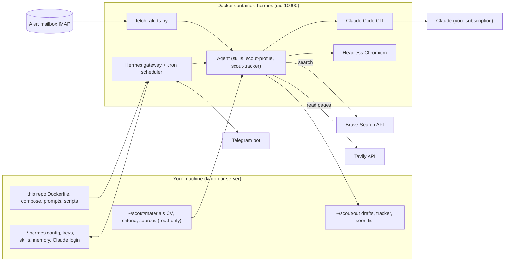

````markdown
# Hermes Job Assistant (HJA)

An always-on research-career agent. Twice a day it searches job boards, fellowship pages and funding calls for openings that fit your profile, checks each listing on the real page, scores it against your criteria, drafts a tailored cover letter and checklist for the strong matches, and reports to you on Telegram. **It never applies for you**: you decide what to apply to, and you submit it yourself.

It's built on Hermes Agent by Nous Research, runs in Docker, and moves between a laptop and a cloud server by copying folders.

---

## What it does

- **Scouts** the sites and search queries you list, plus (optionally) job-alert emails sent to a dedicated mailbox.
- **Verifies** each opportunity by opening its listing: deadline, eligibility, how to apply. Anything it can't confirm is marked `unconfirmed`.
- **Scores** each one (0–100) with your own rubric, and drops hard exclusions.
- **Drafts** a cover letter and a submission checklist for anything scoring 75+.
- **Tracks** everything in one table (`applications.md`): found → drafting → planned → applied → interview / rejected / offer.
- **Reminds** you of deadlines for the applications you've said yes to, at 14, 7, 3 and 1 days.
- **Reports** on Telegram, and stays silent when there's nothing new.

## What it deliberately doesn't do

- Submit applications, send emails, fill in forms, create accounts or pay for anything.
- Read your personal mailbox. The optional alert mailbox is a separate, dedicated account, read by a script; the agent never gets its password.
- Change your documents. Your CV and criteria are mounted read-only.

---

## Architecture



| Component | Role |
|---|---|
| **Hermes gateway** | Long-running service: Telegram connection, cron scheduler, web dashboard. |
| **Agent** | Does the work in each run. Follows `SOUL.md` (standing rules), the skills (your profile, tracker rules) and the job prompt. |
| **Claude Code CLI** | Baked into the image. With the *Claude Subscription DirectSDK* plugin, the agent's model calls go through it, so they run on your Claude subscription instead of a separate API key. |
| **Brave Search / Tavily** | Web search and page reading. Both have free tiers. |
| **Chromium** | Bundled with Hermes, for pages that need a real browser (e.g. JavaScript-heavy job portals). |
| **`fetch_alerts.py`** | Optional. Runs before each scout run, prints unread job-alert emails from the dedicated mailbox, and marks them read. |
| **Cron jobs** | `scout` (every 12 h) and `deadlines` (every 24 h). Each run starts fresh; what it knows comes from the prompt and the skills. |
| **Telegram** | Where reports arrive and where you talk to the agent: send links, say "apply"/"skip", ask for a status summary. |

### Where data lives

| Location (host) | In the container | Contents | In git? |
|---|---|---|---|
| this repo | `/opt/data/prompts`, `/opt/data/scout-scripts` (read-only) | Dockerfile, compose, prompts, scripts, templates | **Yes** |
| `~/scout/materials` | `/opt/data/materials` (read-only) | Your CV, past applications, `criteria.md`, `sources.md` | **No** |
| `~/scout/out` | `/opt/data/scout` | Drafts, `applications.md`, `seen.md` | **No** |
| `~/.hermes` | `/opt/data` | Hermes config, **API keys and tokens**, skills, memory, sessions, Claude login | **No** |
| `.env` (repo root) | — | Dashboard password for Compose | **No** |

The image holds only software. Everything personal lives in those folders, which survive rebuilds and updates, and moving to another machine means copying them.

### Safety design

- **No outbound actions.** The rules in `SOUL.md`, the skills and the job prompts forbid sending, submitting or paying, and the agent has no mail-sending credentials.
- **Read-only inputs.** Materials, prompts and scripts are mounted `:ro`.
- **Untrusted text is data.** Web pages and alert emails are explicitly treated as data, never as instructions (a defence against prompt injection).
- **Restricted tools.** Terminal and code execution are turned off. Hermes also blocks code execution in scheduled runs, where nobody is present to approve it.
- **Unprivileged container.** Hermes runs as uid 10000. SELinux labels (`:Z`) confine it to the mounted folders.
- **Local-only dashboard.** Bound to `127.0.0.1`, password-protected; on a server, reach it through an SSH tunnel.
- **Only you can use the bot.** `TELEGRAM_ALLOWED_USERS` restricts it to your numeric Telegram ID.
- **Limited blast radius.** The keys in `~/.hermes/.env` are for free-tier services. Keep them that way.

> A container shares the host's kernel, so its isolation is weaker than a virtual machine's. For stronger isolation, run it on a cloud server or in a VM.

---

## Requirements

- Linux with Docker Engine and the Compose plugin (tested on Fedora with SELinux enforcing).
- A Claude Pro/Max subscription (via the plugin), **or** another model provider (see *Changing the model*).
- Free accounts: Telegram, Brave Search API, Tavily.
- Optional: a dedicated IMAP mailbox for job alerts (e.g. Posteo).
- About 4 GB of free RAM.

---

## Setup

Commands marked **[host]** run in your normal terminal. Commands marked **[container]** run after connecting with:

```sh
docker exec -it -u 10000 hermes sh
```

Leave the container shell with `exit`.

### 1. Clone and initialise **[host]**
```sh
git clone git@github.com:<your-username>/HJA-HermesJobAssistant.git ~/hermes-scout && cd ~/hermes-scout
bash scripts/init-host.sh
```
This creates `~/.hermes`, `~/scout/materials` and `~/scout/out`, copies the templates, sets permissions for the container user, and writes `.env` with a random dashboard password.

### 2. Add your materials **[host]**
- Put your CV (`.tex` and/or `.pdf`) and any past applications in `~/scout/materials/`. Subfolders are fine.
- Edit `~/scout/materials/criteria.md` (who you are, topics, roles, locations, exclusions, scoring) and `sources.md` (sites and queries).
- Re-apply read permissions after adding files:
```sh
find ~/scout/materials -type d -exec chmod 755 {} + ; find ~/scout/materials -type f -exec chmod 644 {} +
```

### 3. Build **[host]**
```sh
docker compose build
```

### 4. Setup wizard **[host]**
```sh
docker compose run --rm hermes setup
```
Answers: **Full setup** · model provider: **skip** (set in step 6) · terminal backend: **local** · browser: **local** · tools: web search, browser, file operations **on**; terminal and code execution **off** · messaging: **skip**.

### 5. Start **[host]**
```sh
docker compose up -d && docker compose logs --tail 40
```

### 6. Connect the model **[container]**
With a Claude subscription (experimental plugin; Hermes 0.21.4 or newer):
```sh
hermes --version
claude auth login # open the link, approve, paste the code
hermes plugins install claude-subscription-directsdk
hermes model # choose "Claude Subscription DirectSDK (Experimental)", then sonnet
```
For other providers, see *Changing the model*.

Turn off "extra usage" in your Claude account if you never want to pay beyond the subscription.

### 7. Keys and settings **[container]**
See `templates/hermes/hermes.env.example` for the full list.
```sh
echo 'TAVILY_API_KEY=tvly-...' >> /opt/data/.env
echo 'BRAVE_SEARCH_API_KEY=...' >> /opt/data/.env
echo 'TELEGRAM_BOT_TOKEN=123:ABC...' >> /opt/data/.env
echo 'TELEGRAM_ALLOWED_USERS=123456789' >> /opt/data/.env
hermes config set web.search_backend brave-free
hermes config set web.extract_backend tavily
hermes config set display.tool_progress off
hermes config set display.show_reasoning false
exit
```
Use `>>` (append), never `>` (overwrite). Optionally install the standing rules **[host]**:
```sh
docker exec -i -u 10000 hermes sh -c 'cat > /opt/data/SOUL.md' < templates/hermes/SOUL.md
```
Then restart **[host]**: `docker compose restart`.

### 8. Telegram
Message your bot `hi`, then send `/sethome`. Scheduled reports go to that chat.

### 9. Skills (in Telegram)
Paste the contents of these files as messages to the bot, one at a time:
1. `prompts/skill-scout-profile.md`: builds your profile, rubric and writing style.
2. `prompts/skill-scout-tracker.md`: rules for the application tracker.

Check the result **[container]**:
```sh
find /opt/data/skills -name SKILL.md -path '*scout-*' -exec sh -c 'echo "== $1"; cat "$1"' _ {} \;
```
The rubric, thresholds and exclusions must match `criteria.md`.

### 10. Scheduled jobs **[container]**
```sh
sh /opt/data/scout-scripts/create-jobs.sh
hermes cron run <scout-job-id> # first run now; takes 10–20 min
```
Don't restart the container during a run: a restart cancels it (it shows up as `KeyboardInterrupt`).

### 11. Optional: alert mailbox
1. Create a dedicated mailbox with IMAP access (e.g. Posteo; Gmail with an app password also works). Subscribe it to job alerts from EURAXESS, jobs.ac.uk, Academic Positions, Nature Careers, etc.
2. **[container]** Add `SCOUT_IMAP_HOST`, `SCOUT_IMAP_USER` and `SCOUT_IMAP_PASSWORD` to `/opt/data/.env`. Do **not** use `EMAIL_*` names: those enable Hermes' email chat gateway, which would accept emails as instructions.
3. **[container]** Test it: `python3 /opt/data/scout-scripts/fetch_alerts.py`
4. Recreate the jobs (see *Customising*). `create-jobs.sh` attaches the collector automatically when a mailbox is configured.

---

## Daily use (Telegram)

| You send | What happens |
|---|---|
| *(nothing)* | Every 12 h: a report of new matches, top matches (85+) first. Silent if nothing new scores 60+. |
| a job link (optionally "track this" / "draft") | Opened, verified, scored, added to the tracker; drafts written if 60+ or if you say "draft". |
| `apply <slug>` | Marked "planned"; drafts checked; deadline reminders start. |
| `skip <slug>` | Marked "dropped"; never suggested again. |
| `applied to X` / `interview at Y` / `rejected from Z` / `offer from W` | Status and date updated in the tracker. |
| `status` | Open items by deadline, plus counts per status. |

Drafts are in `~/scout/out/drafts/<slug>/` (`cover_letter.md`, `checklist.md`); the tracker is `~/scout/out/applications.md`.

**How it learns:** the model itself doesn't change. Hermes improves by writing things down. Corrections stick only once they're saved in a skill, because each scheduled run starts fresh. After giving feedback (e.g. "cover letters under 400 words, open with the research overlap"), say *"update the scout-profile skill with this"*, then check the skill file.

---

## Customising

| Change | How |
|---|---|
| What fits you | Edit `~/scout/materials/criteria.md`, then ask the bot to update the scout-profile skill. |
| Where it looks | Edit `~/scout/materials/sources.md`. Picked up on the next run. |
| What each run does | Edit `prompts/scout.md` or `prompts/deadlines.md`, then recreate the jobs **[container]**: `hermes cron list`, `hermes cron remove <id>` for each, `sh /opt/data/scout-scripts/create-jobs.sh`. Jobs store their own copy of the prompt. |
| Standing rules | Edit `templates/hermes/SOUL.md`, reinstall it (step 7), restart. |
| Schedule | Change `every 12h` / `every 24h` in `scripts/create-jobs.sh`, then recreate the jobs. |

---

## Changing the model

Hermes talks to one model at a time, set with `hermes model` **[container]**. Scheduled jobs use the same model, so a change applies to every run. Restart afterwards **[host]**: `docker compose restart`.

| Option | How | Cost |
|---|---|---|
| Claude subscription (default) | `hermes model` → *Claude Subscription DirectSDK (Experimental)* → `sonnet`, `opus` or `haiku` | Uses your Pro/Max plan limits |
| Anthropic API key | `hermes model` → Anthropic → paste the key | Pay per token |
| Nous Portal | `hermes model` → Nous Portal (or `hermes setup --portal`) | Nous plan or credits |
| OpenAI / OpenRouter | `hermes model` → choose the provider → paste the key | Pay per token |
| Local or self-hosted model | Set the `model:` block in `/opt/data/config.yaml` (see below) | Your own hardware |

Self-hosted example (e.g. vLLM or Ollama with an OpenAI-compatible API):

```yaml
model:
provider: custom
model: my-model
base_url: http://vllm:8000/v1 # use the container or host name, not localhost
api_key: "none"
```

Notes:
- Provider names in the `hermes model` menu may differ slightly from this table; pick the closest match.
- Sonnet is enough for scouting; Opus writes better cover letters but uses your limits faster.
- Skills, memory and history are plain files, so they carry over to any model.
- Weaker models may ignore rules such as "never guess deadlines". After switching, run the scout once and check its report.
- Remove keys you no longer use from `/opt/data/.env`.

---

## Operations

| Task | Command |
|---|---|
| Status / logs **[host]** | `docker compose ps` · `docker compose logs -f` |
| Dashboard | http://localhost:9119, user `admin`, password = `DASH_PASS` in `.env` |
| Stop / start **[host]** | `docker compose stop` · `docker compose start` |
| Start on boot **[host]** | `sudo systemctl enable docker` (the container has `restart: unless-stopped`) |
| Update Hermes and Claude Code **[host]** | `docker compose build --pull --no-cache && docker compose up -d` |
| Back up **[host]** | `sudo tar czf ~/hja-backup-$(date +%F).tgz -C ~ hermes-scout .hermes scout` |

**Moving to a cloud server:** create a small x86 server (2 vCPU, 4 GB RAM); lock it down (SSH keys only, firewall, automatic updates); install Docker; clone this repo and copy `~/.hermes` and `~/scout` with `rsync -a`; run `sudo chown -R 10000:10000 ~/.hermes ~/scout/out`. **Stop Hermes on the old machine before starting it on the new one**, or both will compete for the same Telegram bot. Then `docker compose up -d --build`. Reach the dashboard with `ssh -L 9119:127.0.0.1:9119 <server>`.

Nothing runs while the container is down. The deadline job catches up on missed reminders at its next run.

---

## Troubleshooting

| Symptom | Cause and fix |
|---|---|
| `PermissionError: [Errno 13]` on `/opt/data/...` | Files in `~/.hermes` owned by the wrong user (often from a non-Docker Hermes install using the same folder). `sudo chown -R 10000:10000 ~/.hermes`, and never run a native `hermes` against that folder. |
| You can't `cd ~/.hermes` on the host | Hermes resets the folder's permissions (the ACL mask) on startup. Expected: manage `~/.hermes` through the container, and keep your own files in `~/scout`. |
| `HTTP 401: invalid x-api-key` | The built-in Anthropic provider has a bad key. Use the subscription plugin (step 6), or set a valid key with `hermes model`. |
| `DDGS search error: No results found` | DuckDuckGo throttles scraped searches. Use Brave: `hermes config set web.search_backend brave-free`. |
| `search-only backend` when reading pages | No page-reading provider. Add `TAVILY_API_KEY` and set `web.extract_backend tavily`. |
| `execute_code … BLOCKED` in cron runs | Code execution is still enabled. Turn it off in `hermes tools`. |
| A run ends with `KeyboardInterrupt` | The container was restarted during the run. Run it again. |
| The bot shows its intermediate steps | `hermes config set display.tool_progress off` and `display.show_reasoning false`, then restart. |
| The bot doesn't answer | Check `TELEGRAM_*` in `/opt/data/.env`, restart, and check `docker compose logs` for Telegram lines. `TELEGRAM_ALLOWED_USERS` must be your numeric ID. |
| Materials subfolders unreadable | Folders need 755, files 644: run the `find … chmod` commands from step 2. |

---

## Costs and limits

- **Model:** with the plugin, runs use your Claude subscription. Anthropic's rules for third-party agents have changed several times in 2026; check the current terms in the Claude Help Center (*"Use the Claude Agent SDK with your Claude plan"*). With an API key you pay per token.
- **Search and page reading:** Brave and Tavily free tiers (check their current quotas). A twice-daily scout with ~7 sites and ~7 queries stays within them; add queries carefully, or reduce the schedule to once a day.
- **Hosting:** free on your own machine; a small cloud server is a few euros a month.
- **Accuracy:** the agent can misread deadlines or eligibility. Every listing links to its source; always check the original before applying.

---

## Repository layout

```
.
├── Dockerfile # official Hermes image + Claude Code CLI
├── compose.yml # container, mounts, dashboard, limits
├── .env.example # copy to .env (dashboard password, optional paths)
├── LICENSE # MIT
├── prompts/
│ ├── scout.md # instructions for each scout run
│ ├── deadlines.md # instructions for the daily deadline check
│ ├── skill-scout-profile.md # message that builds the profile skill
│ └── skill-scout-tracker.md # message that builds the tracker skill
├── scripts/
│ ├── init-host.sh # one-time host setup
│ ├── create-jobs.sh # creates the scheduled jobs (run in the container)
│ └── fetch_alerts.py # optional alert-mailbox collector
└── templates/
├── hermes/ # SOUL.md, list of required keys
├── materials/ # criteria.md, sources.md templates
└── out/ # empty tracker and seen list
```

## License

MIT. See `LICENSE`.

## Acknowledgements

Built on Hermes Agent by Nous Research. Claude and Claude Code are products of Anthropic. This project is unofficial and isn't affiliated with either.
