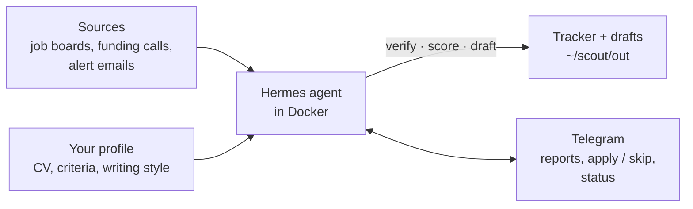

# Hermes Job Assistant (HJA)

[](https://github.com/MKZuziak/HJA-HermesJobAssistant/actions/workflows/ci.yml)
[](LICENSE)

An always-on research-career agent. Twice a day it searches job boards, fellowship pages and funding calls, opens each listing to confirm the deadline and eligibility, scores it against your own criteria, drafts a cover letter and checklist for the strong matches, and reports to you on Telegram.

**It never applies for you.** You decide what to apply to, and you submit it yourself.

Built on [Hermes Agent](https://hermes-agent.nousresearch.com/) by Nous Research. It runs in Docker, and moving between a laptop and a cloud server means copying folders.

## What it does

- **Scouts** the sites and queries you list, plus job-alert emails sent to an optional dedicated mailbox.
- **Drafts emails** into that mailbox (application emails with your CV attached, replies you ask for) for you to review and send. It can't send: there is no SMTP in the project.
- **Verifies** every opportunity on its real page; anything it can't confirm is marked `unconfirmed`.
- **Scores** each one (0–100) with your rubric, and drops your hard exclusions.
- **Drafts** a cover letter in your writing style, plus a submission checklist, for matches scoring 75+.
- **Tracks** everything in one table: found → drafting → planned → applied → interview / rejected / offer.
- **Reminds** you of deadlines for applications you've said yes to (14, 7, 3, 1 days out).
- **Advises**: a weekly market brief with sourced hiring and funding signals, CV tailoring notes for every application you pursue, and honest progress reviews on request.
- **Plans**: a monthly three-month strategy built from your outcomes, debriefs and evolving preferences, framed as a sequence of experiments rather than one big bet.
- **Watches your field**: a daily research radar (new papers, who cites you, labs worth watching), a weekly calls radar for short stays, schools and travel grants, and a monthly visa and residency check per target country, from official sources.
- **Stays quiet** when there is nothing new.

## How it works



The agent follows three layers of instructions: standing rules (`agent/SOUL.md`), skills (your generated profile and the shipped tracker), and the job prompts (`agent/prompts/`). Your documents stay outside the repo and are mounted read-only. Details: [docs/architecture.md](docs/architecture.md).

## Quick start

Requirements: Linux, Docker with the Compose plugin, a Telegram bot, free Brave Search and Tavily API keys, and a model (a Claude subscription by default; [others work too](docs/models.md)).

```sh
git clone https://github.com/MKZuziak/HJA-HermesJobAssistant.git ~/hja && cd ~/hja
make init          # folders, templates, .env, secrets.env
#   → add your CV to ~/scout/materials, edit criteria.md and sources.md, fill in secrets.env
make build
make wizard        # first-run wizard; answers in docs/setup.md
make up
make login         # connect your Claude subscription, choose the model
make bootstrap     # secrets + settings, skills, profile, scheduled jobs
make run           # first scout run now; the report arrives on Telegram
```

The full walkthrough is in [docs/setup.md](docs/setup.md). Run `make` to list every command.

## Using it

| In Telegram | Effect |
|---|---|
| *(wait)* | A report every 12 h, top matches first |
| a job link | Verified, scored, tracked; drafts if it fits |
| `apply <slug>` / `skip <slug>` | Plan it (reminders start) or drop it |
| `applied to X` / `interview at Y` / … | Tracker updated |
| `status` | Open applications by deadline |
| `how am I doing?` | Pipeline review and where to focus |
| `plan` · `note: <impression>` | Current three-month plan · log a reflection for future plans |
| `radar` · `calls` · `visa <country>` | Latest research digest · short stays and calls · visa routes and your standing |

More: [docs/usage.md](docs/usage.md).

## Safety design

- No outbound actions: no sending, submitting applications, account creation or payments; job-alert sign-ups only when you ask. Email is drafts-only: the mailbox is IMAP-only, with no SMTP anywhere.
- Terminal and code execution are disabled; web pages and emails are treated as data, never as instructions.
- Your materials and the agent's own prompts, skills and rules are mounted read-only.
- Runs as your unprivileged user, confined by SELinux labels; the dashboard is local-only and password-protected; the bot answers only your Telegram ID.

The residual risks are covered in [docs/architecture.md](docs/architecture.md#security-model).

## Repository layout

```
├── Makefile                  # every command: make help
├── Dockerfile                # official Hermes image + Claude Code CLI
├── compose.yml               # container, mounts, limits, health check
├── .env.example              # → .env: dashboard password, UID/GID, image tag
├── secrets.env.example       # → secrets.env: API keys, Telegram, mailbox
├── agent/                    # mounted read-only into the container at /opt/hja
│   ├── SOUL.md               # standing rules
│   ├── prompts/              # one per job, plus the profile builder
│   ├── skills/               # scout-tracker, career-advisor, strategist, research-radar, calls-radar, mobility-intel, mailbox
│   └── scripts/              # setup helpers; fetch_alerts.py, mail_sync.py, hja_mail.py, research_radar.py
├── scripts/init-host.sh      # host setup (make init)
├── templates/                # starting files copied once by make init (never put real data here)
├── tests/                    # offline unit tests (python -m unittest)
├── docs/                     # architecture, setup, usage, models, operations, troubleshooting
└── .github/workflows/ci.yml  # shellcheck, hadolint, ruff, unit tests, compose, skill format, gitleaks
```

## Limits

- The agent can misread a deadline or an eligibility rule. Every listing links to its source: check it before applying.
- Search and page reading run on free tiers. The scout twice a day plus the weekly calls radar, with about 7 sites and 7 queries each, stay within them; the research radar uses the arXiv and OpenAlex APIs instead.
- Visa and residency estimates come from official sources but are not legal advice.
- The Claude subscription route uses an experimental plugin, and Anthropic's terms for third-party agents have changed several times. See [docs/models.md](docs/models.md).

## Documentation

[Architecture](docs/architecture.md) · [Setup](docs/setup.md) · [Usage](docs/usage.md) · [Models](docs/models.md) · [Operations](docs/operations.md) · [Troubleshooting](docs/troubleshooting.md)

## Acknowledgements

Thank you to arXiv for use of its open access interoperability. Citation data from [OpenAlex](https://openalex.org) (CC0).

## License

[MIT](LICENSE). Built on [Hermes Agent](https://github.com/NousResearch/hermes-agent) by Nous Research; Claude and Claude Code are Anthropic products. This project is unofficial and isn't affiliated with either.
