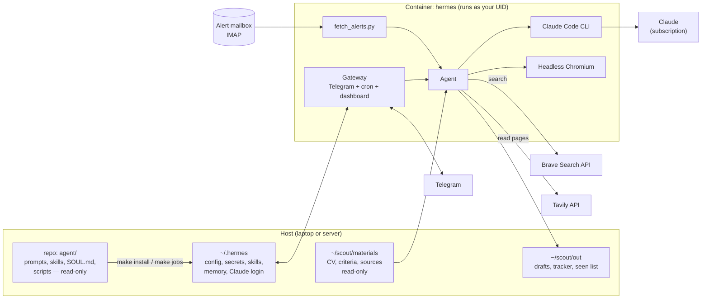

# Architecture

## Components

| Component | Role |
|---|---|
| **Gateway** | Hermes' long-running service, supervised by s6 inside the container: Telegram connection, cron scheduler, web dashboard. |
| **Agent** | Does the work. Each turn it follows `SOUL.md` (standing rules), the attached skills and the prompt. |
| **Skills** | `scout-tracker`, `career-advisor`, `strategist`, `research-radar`, `calls-radar` and `mobility-intel` ship in `agent/skills/` and are installed as-is. `scout-profile` is generated from your own materials by `make profile`, because it is different for every user. |
| **Cron jobs** | See *Schedule* below. Created and updated by name by `agent/scripts/jobs.sh`. Each run starts fresh; it knows only its prompt and its skills. Missed runs are caught up once when the container returns (`--catch-up on`). |
| **Claude Code CLI** | Baked into the image. With the *Claude Subscription DirectSDK* plugin, model calls go through it, so runs use your Claude subscription rather than a separate API key. Any other provider works too: see [models.md](models.md). |
| **Brave / Tavily** | Web search and page reading (`web.search_backend`, `web.extract_backend`). |
| **Chromium** | Bundled with Hermes, for JavaScript-heavy pages such as Workday job portals. |
| **`research_radar.py`** | Runs before each radar job: collects new arXiv papers for your queries and new works citing you from OpenAlex (free API key), and remembers what it already reported. |
| **`fetch_alerts.py`** | Optional. Before each scout run it prints unread job-alert emails from a dedicated mailbox; Hermes injects that output into the run's prompt. |

## Schedule

Wall-clock times are in `HJA_TIMEZONE`.

| Job | When | Skills | Output |
|---|---|---|---|
| `scout` | every 12 h | scout-profile, scout-tracker | new matches, drafts, tracker rows |
| `deadlines` | every 24 h | scout-tracker | reminders for planned applications |
| `radar` | daily 07:00 | research-radar, scout-profile | citations, relevant papers, labs watchlist |
| `calls` | Wednesdays 08:00 | calls-radar, scout-profile, scout-tracker | visits, short fellowships, schools, calls, travel grants |
| `brief` | Mondays 08:00 | career-advisor, scout-profile, scout-tracker | weekly market brief |
| `strategy` | 1st of the month, 09:00 | strategist, scout-profile, scout-tracker, career-advisor | three-month plan |
| `mobility` | 15th of the month, 09:00 | mobility-intel, scout-profile | visa and residency check per country |

## Data layout

| Host path | Container path | Contents | In git |
|---|---|---|---|
| repo `agent/` | `/opt/hja` (ro) | prompts, skills, `SOUL.md`, helper scripts | yes |
| `~/scout/materials` | `/opt/data/materials` (ro) | CV, past applications, `criteria.md`, `sources.md`, `calls.md`, `radar.json`, `guides/` | no |
| `~/scout/out` | `/opt/data/scout` | `drafts/`, `briefs/`, `plans/`, `radar/`, `mobility/`, `applications.md`, `debriefs.md`, `preferences.md`, `seen.md` | no |
| `~/.hermes` | `/opt/data` | Hermes config, `.env` secrets, skills, memory, sessions, cron state, Claude login | no |
| repo `.env`, `secrets.env` | — | dashboard password, UID/GID, image tag; API keys before `make configure` | no (gitignored) |

The image contains only software. Everything personal lives in those folders: it survives rebuilds and updates, and moving to another machine means copying them.

Hermes runs as **your** UID (`HERMES_UID`/`HERMES_GID`, set by `make init`), so every file it writes on the host is owned by you: no `sudo`, no ACLs.

## Request flow of a scout run

1. The scheduler fires `scout`. If a mailbox is configured, `fetch_alerts.py` runs first and its output is prepended to the prompt.
2. The agent loads `scout-profile` and `scout-tracker`, reads `sources.md`, and searches (Brave).
3. For each new candidate (not in `seen.md` or `applications.md`) it opens the listing (Tavily, or Chromium for scripted pages) and confirms deadline, eligibility and how to apply.
4. It scores against the rubric, writes drafts for 75+, and updates the tracker.
5. The final answer goes to Telegram. `[SILENT]` suppresses delivery when nothing new scores 60+.

## Security model

| Measure | What it protects against |
|---|---|
| No outbound actions: `SOUL.md`, the skills and the prompts forbid sending, submitting or paying, and no mail-sending credentials exist | The agent acting on your behalf |
| Terminal and code-execution toolsets disabled on `cli`, `telegram` and `cron` (`make configure`) | Arbitrary command execution, e.g. after a prompt injection |
| Web pages, emails, abstracts and script output explicitly treated as data | Prompt injection through listings or alert emails |
| Materials and repo assets mounted read-only | The agent altering your CV, criteria, prompts or its own rules |
| Mailbox read by a script, not by the agent; `SCOUT_IMAP_*` instead of `EMAIL_*` | Emails becoming instructions via Hermes' email gateway |
| `TELEGRAM_ALLOWED_USERS` | Strangers using your bot |
| Dashboard bound to `127.0.0.1`, password-protected | Network access to the control plane |
| Unprivileged user, SELinux labels (`:Z`), resource limits | Escape from the mounted folders; runaway memory or CPU use |
| Free-tier API keys only | Cost of a leaked key |

Residual risk: the agent can read its own `.env` and has internet access, so a sufficiently clever injected page could try to exfiltrate those keys. Keep them free-tier and rotate them if in doubt. A container shares the host kernel; for stronger isolation run it on a dedicated server or VM.
